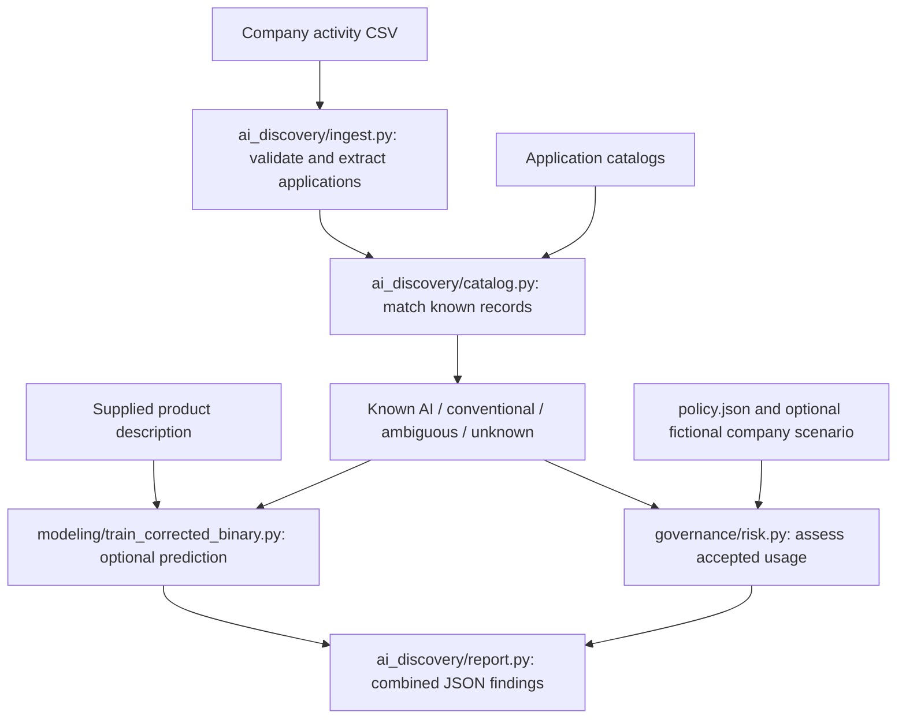

# Cyera — AI Tool Discovery & Risk Classification

A prototype for investigating application usage at a fictional enterprise. It identifies catalog matches, keeps unfamiliar applications visible, summarizes departments/users, and explains governance priorities. The dashboard is paused; the current interface is a Python command that writes a JSON report.

## Start here

```bash
# Run from the repository root. Catalog/risk reporting needs only Python's standard library.
python -m ai_discovery.report --company 'Summit Financial' \
  --activity 'data/raw/summit_financial_usage (1).csv' \
  --out /tmp/summit-report.json
```

Use a new output filename for each run. Optional `--descriptions descriptions.csv --model artifacts/corrected_full_binary` enables the frozen description-only binary classifier for unmatched applications. This requires `modeling/requirements.txt`. No model training, web research or paid API calls happen automatically.

## Where things live

| Folder | Responsibility | Start with |
|---|---|---|
| `ai_discovery/` | Read activity, match applications, optionally research unknowns, produce the combined report | `report.py` |
| `governance/` | Calculate explainable governance priority | `risk.py`, `policy.json` |
| `modeling/` | Train, evaluate and use binary/category models | `train_corrected_binary.py` |
| `preprocessing_scripts/` | Clean data, apply reviewed corrections and prepare training splits | `prepare_corrected_classification.py` |
| `data/raw/` | Original sources and synthetic company activity | `novatech_usage.csv`, `summit_financial_usage (1).csv` |
| `data/processed/` | Prepared tables; different versions serve different jobs | See the data map below |
| `artifacts/` | All checked-in saved models and experiment/report outputs | `corrected_full_binary/`, `discovery_shared/` |
| `tests/` | Automated behavior and consistency checks | `test_discovery.py` |
| `docs/` | Methods, results, limitations and history | [Repository map](docs/repository_map.md) |
| `notebooks/` | Exploratory analysis and earlier runnable experiments | `eda.ipynb` |

## Active pipeline



Descriptions support optional prediction for unmatched identities; ambiguous product identities are not automatically overridden. `ai_discovery/enrich.py` is a separate optional research command, not an automatic report stage. Unknown applications remain visible even without descriptions.

## Data map

- **Active catalog lookup:** `data/raw/kaggle.csv` plus `data/processed/final/dataset_b_final_kaggle_categories.csv`. Uses Sadit's identity and matching rules, including the six resolved subset labels.
- **Original source assignments:** `data/processed/source_membership/`. All 17,292 rows, labeled by dataset origin.
- **Corrected full export:** `data/processed/corrected_labels_2026-11-05/`. 16,740 AI, 516 conventional, 36 unresolved. The six later subset resolutions have not yet been propagated into this frozen training source.
- **Frozen binary training release:** `data/processed/classification_corrected_full/`. 16,674 retained records with grouped train/validation/test splits.
- **Research evidence:** `data/reviews/` and `data/cache/`. Retained to explain and reproduce corrections/vendor suggestions.
- **Synthetic security fields:** Several enriched tables contain fictional controls. The active report does not import these generated catalog controls as vendor facts.

## Saved models and results

| Directory under `artifacts/` | Meaning |
|---|---|
| `corrected_full_binary/` | Current frozen description-only TF-IDF + Logistic Regression binary model |
| `category_tfidf/` | Sadit's TF-IDF category experiment |
| `category_embeddings/` | Sadit's default embedding category experiment and encoder |
| `category_embeddings_tuned/` | Sadit's tuned embedding category experiment and encoder |
| `baseline/`, `embeddings/` | Earlier binary/category/embedding experiments; retained for reproduction |
| `discovery_shared/` | Current sample report summaries |
| `historical/discovery/` | Superseded reports from the previous matching implementation |
| `governance/` | Standalone risk-engine example outputs |

The binary experiment reports test macro F1 0.9243, with 70/73 conventional examples recognized. Its mostly source-assigned labels and failed manual file-storage diagnostic limit real-world reliability. Read [the full results](docs/corrected_full_binary.md).

The saved category comparisons use the earlier 12-category taxonomy. Lookup now uses 14 original Kaggle categories. The active report shows catalog categories and does not invoke those incompatible category models. Retraining/alignment and Jev comparison remain pending.

## Guides

- [Repository map and cleanup changes](docs/repository_map.md)
- [Integrated discovery reports](docs/discovery_reports.md)
- [Corrected labels and vendor reconciliation](docs/corrected_labels.md)
- [Current binary training and results](docs/corrected_full_binary.md)
- [Governance rules and scenarios](docs/governance_risk.md)
- [Original project requirements](Challenge-Project-Overview.md) and [project vision](VISION.md)
- [Historical README, EDA findings and earlier project notes](docs/project_history.md)

## Tests and dependencies

```bash
# In a dedicated virtual environment for the current binary pipeline:
python -m pip install -r modeling/requirements.txt
python -m unittest discover -s tests
```

Optional earlier embedding tests require `modeling/requirements-embeddings.txt`. Sadit's category artifacts were trained in a different package environment; their recorded versions remain in their metrics files. Do not assume one experiment's environment reproduces every historical model. Only load trusted local joblib files.

## Team

Challenge advisor: Shubham Arya. AI coach: Aram Ramos.

Fellows: Forum Shah, Sheila Aquino, Sadit Hussain, Min Thaw Zin, Abigail De Leon, Joshua Hu, and Abdulfattah Ahmed. Joshua's EDA contributions and findings are preserved in the historical project guide and notebook.
