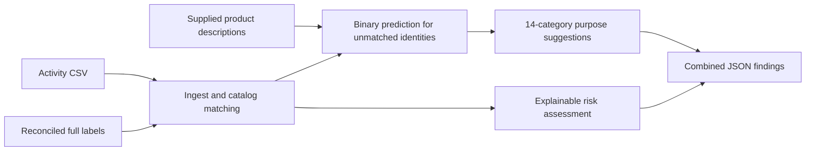

# Cyera — AI Tool Discovery & Risk Classification

A prototype for discovering AI applications in fictional enterprise activity, classifying their purpose and explaining governance concerns. This page describes code currently on `main`; experimental branches are listed separately.

## Where everything lives

| Folder | Job | Key files |
|---|---|---|
| `ai_discovery/` | Ingest, match, optionally research, and produce combined findings | `report.py`, `pipeline.json`, `ingest.py`, `catalog.py`, `enrich.py` |
| `governance/` | Explainable risk calculations and fictional policy scenarios | `risk.py`, `policy.json`, `synthetic_scenarios.json` |
| `modeling/` | All model training, comparison and prediction code | `train_categories.py`, `predict_categories.py`, `train_corrected_binary.py`; earlier reproduction scripts |
| `preprocessing_scripts/` | Cleaning, labeling, category mapping and data enrichment | `apply_conflict_review.py`, `fix_final_ai_labels.py`, `map_kaggle_categories.py` |
| `data/` | Source datasets, prepared tables and evidence | `raw/`, `processed/`, `reviews/`, `cache/` |
| `artifacts/` | All saved models and experiment outputs | See below |
| `tests/` | Automated checks | Dataset, baseline, embedding and governance tests |
| `docs/` | Explanations, limitations and history | [Repository map](docs/repository_map.md) |
| `notebooks/` | Exploratory analysis and earlier experiments | `eda.ipynb` |

## Current integrated workflow



`ai_discovery/report.py` coordinates Sadit's ingestion/catalog matching, optional description-based predictions and the governance engine. `ai_discovery/pipeline.json` names the active data/model versions. Unknown and ambiguous applications remain visible; a model does not automatically override ambiguous identities. Enrichment is a separate optional research command. No web/API calls occur automatically.

```bash
python -m pip install -r modeling/requirements-pipeline.txt
python -m ai_discovery.report --company 'Summit Financial' \
  --activity 'data/raw/summit_financial_usage (1).csv' \
  --out /tmp/summit-current.json

# Also exercise unfamiliar applications with supplied descriptions:
python -m ai_discovery.report --company 'Example Enterprise' \
  --activity data/examples/unseen_activity.csv \
  --descriptions data/examples/unseen_descriptions.csv \
  --out /tmp/example-current.json
```

Read [the release guide](docs/backend_release.md) for results, limitations, preparation/reproduction commands and known diagnostic failures. The dashboard remains paused.

## Saved models

All checked-in saved models now live under `artifacts/`; the old `models/` directory is retired.

| Directory | Contents |
|---|---|
| `artifacts/reconciled_binary_2026-11-11/` | Active description-only binary model, config and test results |
| `artifacts/categories_kaggle14_2026-11-11/` | Active 14-category comparison, three classifiers and selected runtime config |
| `artifacts/backend_release_2026-11-11/` | Current company report summaries and known diagnostic failures |
| `artifacts/category_tfidf/` | Sadit's TF-IDF + Logistic Regression category experiment |
| `artifacts/category_embeddings/` | Sadit's default MiniLM embedding/category experiment |
| `artifacts/category_embeddings_tuned/` | Sadit's tuned embedding/category experiment |
| `artifacts/baseline/` | Earlier binary and category baseline models |
| `artifacts/embeddings/` | Earlier binary/category embeddings and similarity experiment |
| `artifacts/governance/` | Standalone example risk reports |

The new comparison uses 306 eligible AI records and the same 14 original Kaggle categories as lookup. Tuned embeddings achieved 45.75% cross-validation accuracy (macro F1 0.3939). The new binary test score is 99.44% (macro F1 0.9537), against mostly source-assigned labels. These do not establish real-world reliability: the saved diagnostic examples include a false AI prediction for plain file storage and an incorrect coding-helper purpose suggestion. Earlier 12-category and binary experiments remain historical; their scores are not directly comparable. All model predictions request review.

Active category training uses `python -m modeling.train_categories`. Earlier category scripts remain available for 12-category reproduction:

```bash
python -m modeling.train_category_model --help
python -m modeling.train_category_embeddings --help
python -m modeling.tune_category_embeddings --help
```

## Data versions and limitations

- `data/processed/source_membership/`: all 17,292 source-assigned labels, preserved as originally assigned.
- `data/processed/corrected_labels_2026-11-05/`: full reviewed-correction export; 16,740 AI, 516 conventional, 36 unresolved.
- `data/processed/final/dataset_b_final_fixed.csv`: later 697-row subset with six additional resolved labels; 306 AI and 391 conventional.
- `data/processed/final/dataset_b_final_kaggle_categories.csv`: the same subset mapped to 14 original Kaggle categories.
- `data/processed/kaggle_dataset_b/`: prepared catalog/context and a separate synthetic-governance-filled version. Generated security settings are fictional, not verified vendor policies or company approvals.

The later six resolutions are propagated only in the new reconciled release; historical exports remain unchanged. Source-assigned labels and original Kaggle categories are not independently verified truth. Unknown does not mean conventional or safe.

## Current releases and unfinished work

- New full export: `data/processed/reconciled_labels_2026-11-11/`, with 16,741 AI, 521 conventional and 30 unresolved. This propagates the six documented subset resolutions while preserving older source releases.
- New grouped binary splits: `data/processed/classification_reconciled_2026-11-11/`, 16,680 retained applications; 612 set aside with reasons.
- `artifacts/corrected_full_binary/` and `classification_corrected_full/` preserve the earlier PR #19 experiment. It is not the active model.
- Current examples: `artifacts/backend_release_2026-11-11/`. Older shared/combined reports remain historical.
- Dashboard/upload draft: paused outside the repository. Retrieval/RAG and Jev comparison remain unfinished. Independent representative validation and stronger purpose labels are still needed.

## Setup, tests and documentation

The root `requirements.txt` records the broader team environment. Earlier binary/embedding experiments have their own pinned lists in `modeling/requirements*.txt`; package versions differ between experiments. Use a suitable dedicated virtual environment and do not assume every saved model is compatible with every environment.

```bash
python -m unittest discover -s tests
```

- [Current backend release, results and limitations](docs/backend_release.md)
- [Repository map and cleanup details](docs/repository_map.md)
- [Corrected labels and vendor provenance](docs/corrected_labels.md)
- [Governance engine](docs/governance_risk.md)
- [Earlier baseline](docs/baseline_classification.md) and [embedding experiment](docs/embedding_classification.md)
- [Historical README and EDA findings](docs/project_history.md)
- [Project requirements](Challenge-Project-Overview.md) and [vision](VISION.md)

Challenge advisor: Shubham Arya. AI coach: Aram Ramos. Fellows: Forum Shah, Sheila Aquino, Sadit Hussain, Min Thaw Zin, Abigail De Leon, Joshua Hu and Abdulfattah Ahmed. Joshua's EDA contributions are preserved in the notebook and historical guide.
