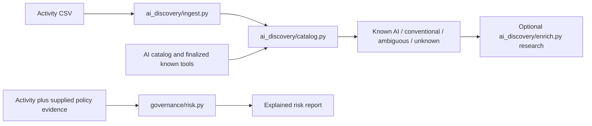

# Cyera — AI Tool Discovery & Risk Classification

A prototype for discovering AI applications in fictional enterprise activity, classifying their purpose and explaining governance concerns. This page describes code currently on `main`; experimental branches are listed separately.

## Where everything lives

| Folder | Job | Key files |
|---|---|---|
| `ai_discovery/` | Extract applications, match catalogs, optionally collect cited research | `ingest.py`, `catalog.py`, `enrich.py` |
| `governance/` | Explainable risk calculations and fictional policy scenarios | `risk.py`, `policy.json`, `synthetic_scenarios.json` |
| `modeling/` | All model training, comparison and prediction code | `train_category_model.py`, `train_category_embeddings.py`, `tune_category_embeddings.py`; earlier baseline/embedding code |
| `preprocessing_scripts/` | Cleaning, labeling, category mapping and data enrichment | `apply_conflict_review.py`, `fix_final_ai_labels.py`, `map_kaggle_categories.py` |
| `data/` | Source datasets, prepared tables and evidence | `raw/`, `processed/`, `reviews/`, `cache/` |
| `artifacts/` | All saved models and experiment outputs | See below |
| `tests/` | Automated checks | Dataset, baseline, embedding and governance tests |
| `docs/` | Explanations, limitations and history | [Repository map](docs/repository_map.md) |
| `notebooks/` | Exploratory analysis and earlier experiments | `eda.ipynb` |

## Current discovery workflow



Ingestion preserves accepted/rejected record details and source-row mappings. Catalog matching preserves product paths and uncertainty. Enrichment collects cited reports for review; it does not automatically establish identities or classify unknowns. Governance is currently a separate command on `main`.

```bash
# Standard-library-only catalog matching; run from the repository root.
python -m ai_discovery.catalog \
  --activity data/raw/novatech_usage.csv \
  --ai-catalog data/raw/kaggle.csv \
  --known-tools data/processed/final/dataset_b_final_kaggle_categories.csv

python -m governance.risk --company 'Summit Financial' \
  --activity 'data/raw/summit_financial_usage (1).csv' \
  --out /tmp/summit-risk.json
```

## Saved models

All checked-in saved models now live under `artifacts/`; the old `models/` directory is retired.

| Directory | Contents |
|---|---|
| `artifacts/category_tfidf/` | Sadit's TF-IDF + Logistic Regression category experiment |
| `artifacts/category_embeddings/` | Sadit's default MiniLM embedding/category experiment |
| `artifacts/category_embeddings_tuned/` | Sadit's tuned embedding/category experiment |
| `artifacts/baseline/` | Earlier binary and category baseline models |
| `artifacts/embeddings/` | Earlier binary/category embeddings and similarity experiment |
| `artifacts/governance/` | Standalone example risk reports |

Category comparisons used 306 eligible AI records and 12 purpose categories. The later lookup data uses 14 original Kaggle categories. These are different label schemes: saved category models need alignment/retraining before being used with that lookup taxonomy. Cross-validation results are not an independent final benchmark.

Moved scripts support module execution:

```bash
python -m modeling.train_category_model --help
python -m modeling.train_category_embeddings --help
python -m modeling.tune_category_embeddings --help
```

## Data versions and limitations

- `data/processed/source_membership/`: all 17,292 source-assigned labels, preserved as originally assigned.
- `data/processed/corrected_labels_2026-11-05/`: full reviewed-correction export; 16,740 AI, 516 conventional, 36 unresolved.
- `data/processed/final/dataset_b_final_fixed.csv`: later 697-row subset with six additional resolved labels; 306 AI and 391 conventional.
- `data/processed/final/dataset_b_final_kaggle_categories.csv`: the same subset mapped to 14 original Kaggle categories.
- `data/processed/kaggle_dataset_b/`: prepared catalog/context and a separate synthetic-governance-filled version. Generated security settings are fictional, not verified vendor policies or company approvals.

The later six subset resolutions have not been propagated into the full corrected export. Source-assigned labels and original Kaggle categories are not independently verified truth. Unknown does not mean conventional or safe.

## Work not merged by this cleanup

- [PR #19](https://github.com/Break-Through-Tech/Cyera-1B-ai-tool-discovery-and-risk-classification/pull/19): new grouped full-data binary experiment.
- `shared-discovery-backend`: combined reporting using the shared ingestion/catalog pipeline, optional frozen binary predictions and risk assessment.
- Dashboard/upload draft: paused, stored outside the repository, not published.

This cleanup moves files and updates paths/documentation only. It does not merge those features, retrain models, change dataset labels or alter risk rules. Jev comparison and the RAG assistant remain unfinished.

## Setup, tests and documentation

The root `requirements.txt` records the broader team environment. Earlier binary/embedding experiments have their own pinned lists in `modeling/requirements*.txt`; package versions differ between experiments. Use a suitable dedicated virtual environment and do not assume every saved model is compatible with every environment.

```bash
python -m unittest discover -s tests
```

- [Repository map and cleanup details](docs/repository_map.md)
- [Corrected labels and vendor provenance](docs/corrected_labels.md)
- [Governance engine](docs/governance_risk.md)
- [Earlier baseline](docs/baseline_classification.md) and [embedding experiment](docs/embedding_classification.md)
- [Historical README and EDA findings](docs/project_history.md)
- [Project requirements](Challenge-Project-Overview.md) and [vision](VISION.md)

Challenge advisor: Shubham Arya. AI coach: Aram Ramos. Fellows: Forum Shah, Sheila Aquino, Sadit Hussain, Min Thaw Zin, Abigail De Leon, Joshua Hu and Abdulfattah Ahmed. Joshua's EDA contributions are preserved in the notebook and historical guide.
