# Cyera — AI Tool Discovery & Risk Classification

Investigate application usage at a fictional enterprise: identify AI tools, suggest their purpose, summarize usage, explain governance concerns, and retrieve the evidence behind findings. The unified dashboard preserves the team’s reviewed company reports, investigation views, heatmaps and trends, and adds offline CSV analysis and local evidence questions. Jev has processed all 17,107 unique identities in the current catalog (9,814 AI-focused, 1,412 conventional, 5,881 unknown/review). The separate 21-app enterprise demo remains available; viewing saved results makes no paid calls.

## Try the dashboard

```bash
python -m pip install -r dashboard/requirements.txt
python -m streamlit run dashboard/app.py
```

See [dashboard setup and modes](dashboard/README.md) and the [dashboard recording guide](docs/dashboard_demo.md) for input requirements, a walkthrough, and the distinction between saved decisions and fresh activity analysis. No API key is needed for this offline demo.

## Current workflow

```mermaid
flowchart LR
    A[Synthetic enterprise activity] --> B[Ingestion and catalog matching]
    B --> C[Optional evidence retrieval and AI classification]
    C --> D[Purpose categorization]
    D --> E[Governance evidence and explainable scoring]
    E --> F[Saved Component 4 report]
    F --> G[Local FAISS semantic search]
    G --> H[Company-scoped analyst questions and citations]
    H --> I[Optional generated RAG draft]
```



- **Components 1–4:** Sadit's current operational workflow is `ai_discovery/run_pipeline.py`. Read [the pipeline guide](ai_discovery/PIPELINE_GUIDE.md) and [Component 4 contract](docs/component4_integration.md). The report preserves exact identities, accepted/rejected events, category provenance, governance evidence and missingness. Online discovery/research are separately enabled; they are not automatic defaults.
- **Grounded answer validation:** [26 functional cases and strict fact selection](docs/answer_validation.md), including unknown scores, control predicates and abstention.
- **Evidence search and analyst questions:** `ai_discovery/retrieval.py` and `ai_discovery/ask.py` consume saved Component 4 reports. They do not rerun paid discovery, retrain models or change scores. Read [the assistant guide](docs/governance_assistant.md).
- **Earlier local-model backend:** `ai_discovery/report.py` and `pipeline.json` retain the November 11 experimental binary/category workflow. Its compatibility with current catalog code is restored, but it is not the latest operational Components 1–4 runner. Read [that historical release](docs/backend_release.md).

## Where code lives

| Location | Job |
|---|---|
| `ai_discovery/ingest.py`, `catalog.py` | Extract observed applications and match exact known identities |
| `ai_discovery/jev.py`, `jev_catalog.py` | Jev product classification for enterprise samples and the full current catalog |
| `ai_discovery/enrich.py`, `classify.py` | Optional cited product research and AI/non-AI decisions |
| `ai_discovery/categorize.py`, `run_pipeline.py` | Category inference/cache and integrated Components 1–4 |
| `governance/risk.py`, `evidence.py`, `research.py` | Scoring, company-scoped evidence and optional control research |
| `ai_discovery/retrieval.py`, `ask.py`, `evaluate_retrieval.py` | Index report evidence, answer questions and run labeled search checks |
| `category_training/` | Current larger Kaggle-14 category training package; see the pipeline guide |
| `modeling/` | Earlier binary/category experiments and optional dependency lists |
| `preprocessing_scripts/` | Data preparation, correction, enrichment and comparison utilities |
| `data/` | Source data, prepared tables, review evidence and saved pipeline runs |
| `artifacts/` | Historical model metrics/reports and small validation examples |
| `dashboard/app.py`, `data.py`, `workflow.py` | Unified interface, team report views, saved Jev lookup, uploads and report questions |
| `ai_discovery/dashboard_data.py` | Operational ingestion/catalog/governance adapter for fresh uploaded activity |
| `tests/` | Automated behavior and consistency checks |
| `docs/`, `notebooks/` | Methods, limitations, history and exploratory analysis |

Trained weights, encoders, virtual environments and derived vector indexes are **local artifacts**, excluded from Git. Do not force-add them. Preserve run manifests and metrics; train locally or supply your existing encoder/model bundles. Different training experiments have different environments and data contracts.

## Try report search without paid calls

Install the optional search dependencies in a dedicated environment. You need an existing local Sentence Transformers encoder bundle; index building does not download one.

```bash
python -m pip install -r modeling/requirements-retrieval.txt

python -m ai_discovery.retrieval \
  --report data/processed/pipeline_runs/novatech_component4_v2.json \
  --encoder /path/to/local/MiniLM/encoder \
  --out data/cache/governance_retrieval/novatech-v2

python -m ai_discovery.ask \
  --index data/cache/governance_retrieval/novatech-v2 \
  --company NovaTech --question 'Why was Salesforce flagged?'
```

Default answers are local evidence summaries with citations, not LLM-generated prose. Optional `--generate --api-model YOUR_MODEL` enables a Gemini RAG draft and may incur cost. Live generation remains unvalidated in this delivery. Company/department/status filters, synthetic controls, incomplete evidence and whole-application user-count scope remain visible. Similarity is relevance, not verification or security confidence.

## Validation and limitations

The unified dashboard integration passes **203 automated tests** in the local validation environment, including 14 retrieval/answer checks and 9 additional grounding/QA checks. Six named-application search smoke queries returned the intended application first; this small developer-authored set is not a broad or independent retrieval benchmark. The 26 developer-authored functional cases also pass; this is not a general answer-accuracy benchmark. Live answer-quality evaluation is still needed.

Model accuracy figures refer to specific datasets and contracts; do not present earlier 306-row category results as results of the newer full-Kaggle category pipeline. Source-assigned labels, provisional predictions and generated controls are not independently verified truth. Synthetic governance settings demonstrate the project workflow and are labeled; missing evidence never establishes safety.

## Guides and remaining work

- [Jev classification and completed catalog/sample runs](docs/jev_classification.md)
- [Current discovery/category/governance pipeline](ai_discovery/PIPELINE_GUIDE.md)
- [Component 4 evidence and scoring](docs/component4_integration.md)
- [New report retrieval and analyst assistant](docs/governance_assistant.md)
- [Original requirements](Challenge-Project-Overview.md) and [vision](VISION.md)
- [November 11 model experiment](docs/backend_release.md), [older baseline](docs/baseline_classification.md), [older embeddings](docs/embedding_classification.md)
- [Dataset corrections](docs/corrected_labels.md), [historical project notes](docs/project_history.md)

Next: broader independently reviewed retrieval/answer evaluation, optional live RAG-provider validation, stronger discovery evidence/model validation, and a held-out Jev/local-model comparison. The offline dashboard is available; Jev catalog and sample classification runs are complete; new identities require a separate API classification run.

Challenge advisor: Shubham Arya. AI coach: Aram Ramos. Fellows: Forum Shah, Sheila Aquino, Sadit Hussain, Min Thaw Zin, Abigail De Leon, Joshua Hu and Abdulfattah Ahmed.
