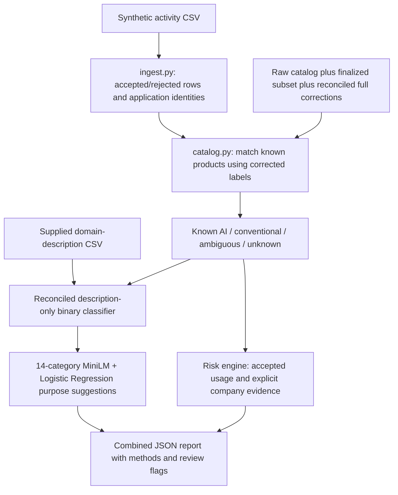

# Reconciled backend and modeling release — November 11, 2026

This release completes the current data/model consistency and backend integration work. It does not complete the entire project: the dashboard remains paused, and retrieval/RAG, Jev comparison and stronger independent validation remain future work.

## What is now connected



Ambiguous identities are never automatically overridden by a model. Model prediction requires a supplied description and a uniquely observed endpoint. Matched catalog categories take precedence; the purpose model supplies suggestions only when AI has been predicted/identified and a category is absent. Missing descriptions and controls remain unknown. No web/API calls happen automatically.

## Data reconciliation

`preprocessing_scripts/reconcile_scope_resolutions.py` propagates Sadit's six documented scope decisions into a new full export, `data/processed/reconciled_labels_2026-11-11/`. Only the six formerly unresolved records and their associated review/gating fields change. Names, descriptions, vendors, original labels and older source releases are preserved.

New full counts: **16,741 AI, 521 conventional, 30 unresolved**, out of 17,292 rows. The six decisions are one AI (Semrush Outline Builder) and five conventional (Freshworks, Notion, Airtable, Podium and Bubble), under the supplied primary-product-scope definition. Conventional does not mean a product has no AI features. Evidence/reasons travel in the release summary. The old subset audit hash uses Windows CRLF; reconstructing that encoding exactly matches the recorded hash. The new summary records both stored input hashes and that verified relationship.

New grouped splits are in `data/processed/classification_reconciled_2026-11-11/`. Of 17,292 inputs, 16,680 are retained and 612 set aside: 30 unresolved, 528 missing names/descriptions, 19 invalid domains, 35 duplicates. The grouping rules are unchanged; fixed seed is 20261111. All input rows are accounted for. Earlier frozen splits remain byte-reproducible.

| Split | AI | Conventional | Total |
|---|---:|---:|---:|
| Training | 11,330 | 346 | 11,676 |
| Validation | 2,428 | 74 | 2,502 |
| Test | 2,428 | 74 | 2,502 |

The active catalog matcher can apply this full correction export to both raw-catalog and finalized-subset records after checking source IDs, original/corrected names and host identity. Explicit unresolved labels are retained as ambiguous; they are not dropped and then replaced with the catalog's original AI assumption.

## Binary model

`artifacts/reconciled_binary_2026-11-11/` contains a new description-only TF-IDF + Logistic Regression model. Names, vendors, source/review fields, categories and governance fields are not features. Training-derived balanced sample weights address class imbalance. Validation macro F1 compares C=0.1/1/10 and selects C=10; threshold stays 0.5. The model is saved before the separate test command. No validation/test refit or post-test tuning occurs.

| Metric | Model | Always AI baseline |
|---|---:|---:|
| Test accuracy | 99.44% (2,488/2,502) | 97.04% |
| Test macro F1 | 0.9537 | 0.4925 |

Confusion matrix, true rows/predicted columns, order conventional then AI:

```text
[[71,    3],
 [11, 2417]]
```

This recognizes 71/74 conventional examples. The new dataset/seed differs from the earlier experiment, so the higher score is not a controlled improvement claim. Labels remain largely source-assigned; source writing style, incomplete alias grouping and prior exposure limit generalization. This is not a new independently collected benchmark.

## Categories: one active 14-category scheme

`modeling/train_categories.py` reuses Sadit's description loading/grouping and classifier approaches, but explicitly validates all 14 original Kaggle labels. It compares TF-IDF, fixed MiniLM embeddings and tuned MiniLM embeddings on the same 306 eligible AI records and grouped outer folds. Non-AI records are excluded from category training. The smallest category has only four records.

The frozen encoder is reused locally from `artifacts/category_embeddings/encoder`; no encoder weights are updated or downloaded. Runtime is Sentence Transformers 6.2.0, matching the saved encoder's module layout. New classifiers use the current scikit-learn environment recorded in their config; older fitted artifacts are preserved.

Four outer folds evaluate predictions; two inner grouped folds select C and class weighting for the tuned approach. A deterministic structural seed search ensures training-category coverage without consulting model scores. Related groups never cross folds. Fold assignments are saved. The settings grid is C=0.01/0.1/1/10/100, with and without balancing.

| Approach | CV accuracy | Macro F1 |
|---|---:|---:|
| TF-IDF + Logistic Regression | 32.03% | 0.2437 |
| MiniLM + fixed Logistic Regression | 45.10% | 0.3862 |
| MiniLM + tuned Logistic Regression | **45.75%** | **0.3939** |
| Majority-category baseline | 25.49% | 0.0290 |

The tuned embedding family is selected for provisional suggestions. Family selection uses these CV estimates, so they are exploratory model-comparison results, not an untouched final test. Final deployment classifiers are refitted on all 306 eligible records afterward. The 12-category historical scores are not directly comparable. All category outputs request review and scores are uncalibrated.

`artifacts/categories_kaggle14_2026-11-11/` holds all three classifiers, comparisons, out-of-fold predictions, per-category reports/confusion matrices, exclusions, hashes, versions and the active selection config. `modeling/predict_categories.py` validates taxonomy, model/encoder hashes and class sets before prediction. The shared encoder is referenced instead of duplicating its 90MB weights again.

## Known diagnostic failures

`data/examples/unseen_activity.csv` and `unseen_descriptions.csv` use fictional application identities absent from the catalog. They are routing demonstrations with previously known handwritten diagnostic descriptions, not independent evaluation data.

- Coding helper: binary AI score 0.9978 correctly predicts AI; the category suggestion is incorrectly Education And Learning (0.1209), with Technology And Development second (0.1117).
- Conventional file storage: incorrectly predicted AI, score 0.8793, and consequently receives an inappropriate purpose suggestion.

These failures are saved in `artifacts/backend_release_2026-11-11/unseen-diagnostic.json`. They were not used to tune models or select thresholds. They show why high binary dataset scores do not establish reliable everyday-description performance. The backend is connected; predictions are experimental, not production-ready.

## Run

```bash
python -m pip install -r modeling/requirements-pipeline.txt

python -m ai_discovery.report --company 'Summit Financial' \
  --activity 'data/raw/summit_financial_usage (1).csv' \
  --out /tmp/summit-current.json

# Exercises unknown-description binary and category prediction:
python -m ai_discovery.report --company 'Example Enterprise' \
  --activity data/examples/unseen_activity.csv \
  --descriptions data/examples/unseen_descriptions.csv \
  --out /tmp/example-current.json

# Optional explicitly fictional company policy:
# --scenarios governance/synthetic_scenarios.json
```

`ai_discovery/pipeline.json` lists the active paths and taxonomy. CLI defaults use the new binary/category models and full corrections. Reporting preserves Sadit's ingestion/event-count policy, rejected rows and mappings; scoring uses accepted rows only. Root `requirements.txt` and older experiment dependency lists remain historical/separate environment records.

Current sample summaries are under `artifacts/backend_release_2026-11-11/`: Summit has 6 AI, 7 conventional, 9 unresolved identities; NovaTech has 6/7/8. These are catalog-coverage counts, not accuracy. DocuMind remains unknown with observed risk 30; explicit fictional unapproved status changes it to 55. Generated catalog governance columns are not imported as vendor facts.

## Reproduce preparation/training

Use fresh output directories for training. Frozen test evaluation refuses existing reports.

```bash
python preprocessing_scripts/reconcile_scope_resolutions.py --check
python preprocessing_scripts/prepare_corrected_classification.py \
  --source data/processed/reconciled_labels_2026-11-11/all_corrected.csv \
  --out data/processed/classification_reconciled_2026-11-11 \
  --version reconciled-full-2026-11-11 --seed 20261111

python modeling/train_corrected_binary.py train \
  --data data/processed/classification_reconciled_2026-11-11 \
  --out /tmp/reproduced-binary
python modeling/train_corrected_binary.py evaluate \
  --data data/processed/classification_reconciled_2026-11-11 \
  --out /tmp/reproduced-binary

python -m modeling.train_categories --out /tmp/reproduced-categories
python -m unittest discover -s tests
```

Later work should prioritize independently reviewed, representative evaluation descriptions and better category labels/coverage. RAG/retrieval, Jev and the paused dashboard remain separate steps.

## Release validation

All **81 tests pass** in the pinned pipeline environment. They cover original data/model/governance behavior, six-label reconciliation, byte reproduction of both split versions, category/group coverage, unresolved-label safeguards, correction precedence, taxonomy validation and end-to-end model/risk routing. `pip check` reports no broken requirements. These checks validate implementation and consistency; they do not certify prediction correctness. The known incorrect handwritten outputs remain in the release.
