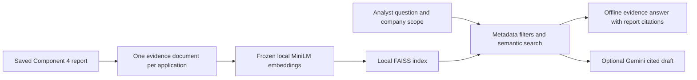

# Governance evidence retrieval and analyst questions

**Current extension:** [answer validation and schema-2 indexes](answer_validation.md) supersedes the earlier generated-prose contract. Rebuild indexes with current code; optional generation now selects exact field/value facts rather than accepting free text. Unknown scores, control predicates and unsupported-question abstention are supported.

This adds a report-search and analyst-question layer on top of Sadit's Component 4 reports. It does not change model training, AI decisions, categories, governance points or the paused dashboard.

## What runs



`ai_discovery/retrieval.py` builds and reads the index. It preserves company, exact application identity, category/source/status, usage counts, governance reasons, missing fields, control provenance and synthetic flags. It omits raw enrichment reports/HTML, individual employee IDs and event logs. Each document cites the source report SHA-256 and `/results/N` JSON pointer.

`ai_discovery/ask.py` accepts a question, requires an explicit company, and returns structured findings and an evidence-based text summary. Default mode is entirely local; it is a templated evidence assistant, not a generated LLM conversation. Optional `--generate` enables retrieval-augmented Gemini drafting. No paid calls were made during this implementation.

## Install and build

```bash
python -m pip install -r modeling/requirements-retrieval.txt

python -m ai_discovery.retrieval \
  --report data/processed/pipeline_runs/novatech_component4_v2.json \
  --encoder /path/to/local/MiniLM/encoder \
  --out data/cache/governance_retrieval/novatech-v2
```

The default encoder location is `artifacts/category_embeddings/encoder` if you already have that local bundle. The team stopped committing encoders/weights; supply an existing local Sentence Transformers encoder directory when needed. The command uses `local_files_only=True`: it does not download models or update their weights. For this validation, the previously available local MiniLM bundle was preserved across the repository's model-untracking update.

FAISS stores normalized float32 embeddings in an exact inner-product index, equivalent to cosine ranking after normalization. Similarity measures relevance, not truth, identity verification, classification confidence or breach probability. The index and document count/dimensions are checked together; manifest hashes validate the index files, original report snapshots and encoder. A changed source requires a new index.

An index may contain multiple companies, but only one report snapshot per company. Queries cannot search all companies at once. Mixing reports from different times for the same company is refused to avoid double-counting applications. Index outputs are new directories, never overwritten. Derived index files stay local/ignored by Git.

## Ask questions

```bash
python -m ai_discovery.ask \
  --index data/cache/governance_retrieval/novatech-v2 \
  --company NovaTech --question 'Why was Salesforce flagged?'

python -m ai_discovery.ask \
  --index data/cache/governance_retrieval/novatech-v2 \
  --company NovaTech \
  --question 'How many unapproved AI tools are used by Finance?'

python -m ai_discovery.ask \
  --index data/cache/governance_retrieval/novatech-v2 \
  --company NovaTech --question 'What are the highest-risk applications?' \
  --top-k 3 --out /tmp/novatech-priorities.json
```

The small, transparent wording parser recognizes one department, known application names, AI/conventional/unknown status, explicit high/medium/low-risk wording and approval status. It is not general natural-language understanding. Every inferred filter is returned as `applied_filters`. Multiple mentioned departments/applications require clearer scope. Explicit `--department`, `--application`, `--ai-status`, `--risk-level`, `--approval` override inference; `--no-infer` uses only explicit filters. Endpoints and application IDs can be selected explicitly.

Counts use every matching record in the company snapshot, not only semantic top-k hits. Highest-risk questions sort numeric scores, not embedding similarity. Other questions retrieve semantic evidence. Department filtering means the application is used there; user counts remain whole-application counts across all departments, not department-specific user counts. A missing or differently scoped approval stays unknown, never automatically unapproved. Zero matches establishes only zero matching records in the supplied snapshot.

Offline answers include source evidence IDs, observed priority, approval, departments, rule explanations, missing evidence, supplied control values/provenance, category provenance and synthetic caveats. Full results include similarity, exact report pointers, matching IDs and the full filtered count. Retrieved neighbors are not automatically accepted as the identity mentioned in a question.

## Validated example results

On the saved **NovaTech Component 4 v2 snapshot**, containing 21 application identities:

- Salesforce: conventional primary purpose, priority 60/high, explicit fictional unapproved status and control evidence. The answer explains each recorded rule and labels the scenario evidence synthetic.
- Unapproved applications used by Finance: 3 matching records (LinkedIn, Salesforce and Slack).
- Unapproved **AI** applications used by Finance: 0 matching records in this snapshot. This differs from counting every unapproved application.
- Highest priorities: Slack 75, LinkedIn 65, Salesforce 60. These are prototype scenario priorities, not real-world vendor-security ratings.

Results depend on the exact snapshot; later research/repaired reports can differ. Checked-in examples and the small search evaluation are in `artifacts/governance_retrieval_2026-11-18/`.

Six developer-authored, named-application smoke queries were evaluated with semantic ranking **without** natural-language metadata inference. Intended applications ranked first for 6/6 queries (hit@1=1.0, hit@3=1.0, MRR@3=1.0). The six labels refer to one fictional report, are easy name-bearing examples and are not independently reviewed. This is a wiring smoke check, not evidence of general retrieval quality or generated-answer accuracy. Queries and source hash are saved in `data/reviews/retrieval_2026-11-18/queries.json`. No model/threshold was tuned against these queries.

```bash
python -m ai_discovery.evaluate_retrieval \
  --index data/cache/governance_retrieval/novatech-v2 \
  --queries data/reviews/retrieval_2026-11-18/queries.json \
  --out /tmp/retrieval-evaluation.json
```

## Optional generated RAG draft

Install `google-genai==3.0.0` (also in the team's root requirements), set `GEMINI_API_KEY` in your environment, and explicitly enable generation:

```bash
python -m ai_discovery.ask \
  --index data/cache/governance_retrieval/novatech-v2 \
  --company NovaTech --question 'Why was Salesforce flagged?' \
  --generate --api-model YOUR_SUPPORTED_MODEL_ID
```

This sends the question and retrieved application/control facts to Gemini, may incur cost, and has a 60-second request timeout with automatic retries disabled. It does not send raw activity or employee identifiers. Deterministic count questions never invoke generation. The provider selects exact cited fields/values; application code validates equality and renders them with provenance. Invented values/prose are rejected. This does not establish source truth or question relevance. See [the current generation contract and limitations](answer_validation.md). Live Gemini generation and independent answer-quality evaluation remain unvalidated.

## Compatibility repair included

The November 15 catalog update had removed optional full-correction support while the older `report.py` still called it, causing seven baseline errors and one unresolved-label failure. This change restores the optional correction argument and unresolved-label safeguard while preserving Sadit's newer shared-suite-host restrictions. The operational runner's default matching policy is unchanged when no corrections are passed. Existing and new workflows now coexist without reverting the new Component 3/4 work.

## Next validation

Build a broader independently reviewed question set with paraphrases, negative queries, conflicting controls, multiple companies and held-out applications. Then validate generated answers for citation support and useful abstention, and test a live provider call only when desired. The dashboard remains paused; Jev comparison is separate work.

Implementation references: [FAISS getting started](https://github.com/facebookresearch/faiss/wiki/Getting-started), [Google Gen AI SDK](https://googleapis.github.io/python-genai/).

## Initial retrieval delivery validation

All **151 tests pass** in the local validation environment: 137 existing checks plus 14 new retrieval/answer checks. The new cases cover company isolation before top-k, full-snapshot counts, AI/approval filtering, numeric priority ranking, no-match behavior, source/index changes, duplicate/mixed company snapshots, approval scope, synthetic/provisional caveats, explicit-filter overrides, provider failures without retries and citation validation. `pip check` found no broken requirements. The installed Gemini SDK accepted the configured timeout and disabled retries in a no-request configuration check. No live generation, discovery or governance-research calls were made.
